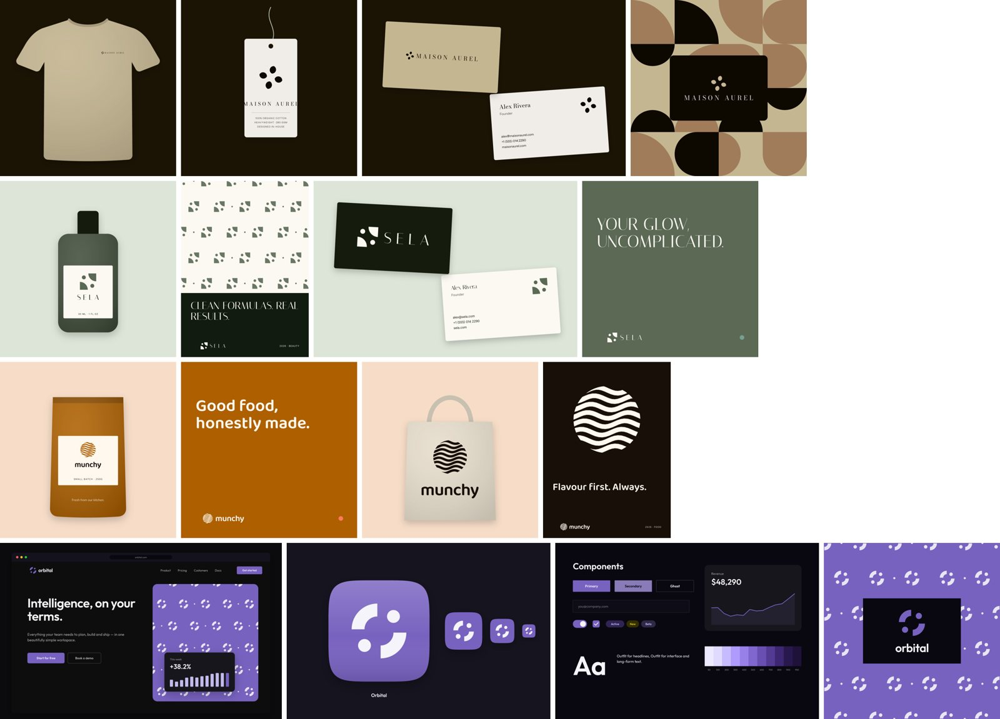
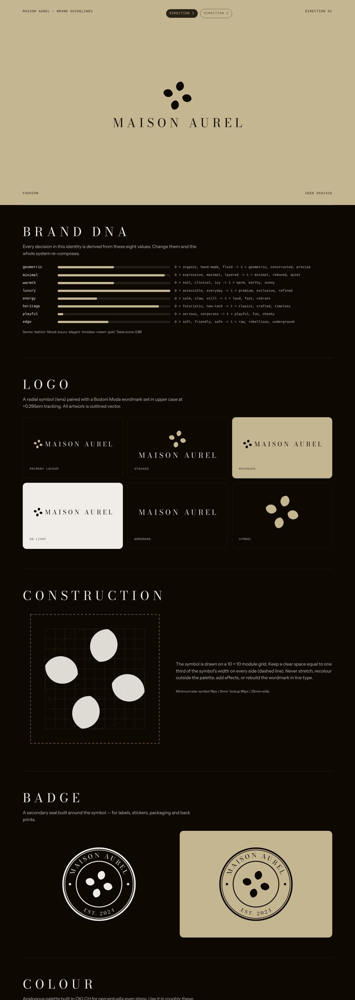
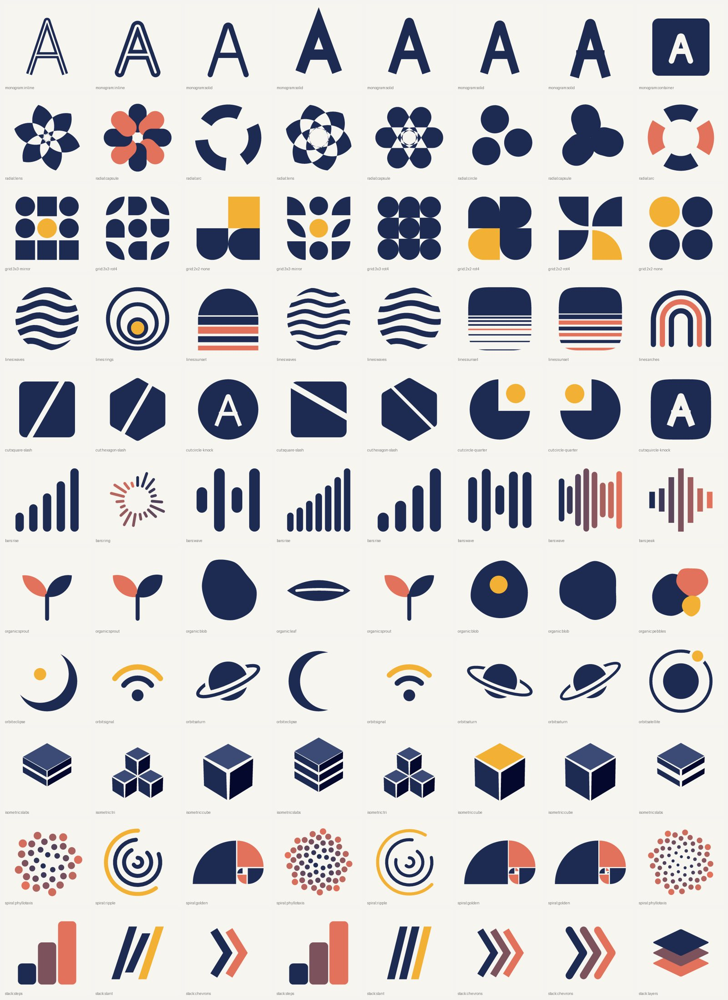
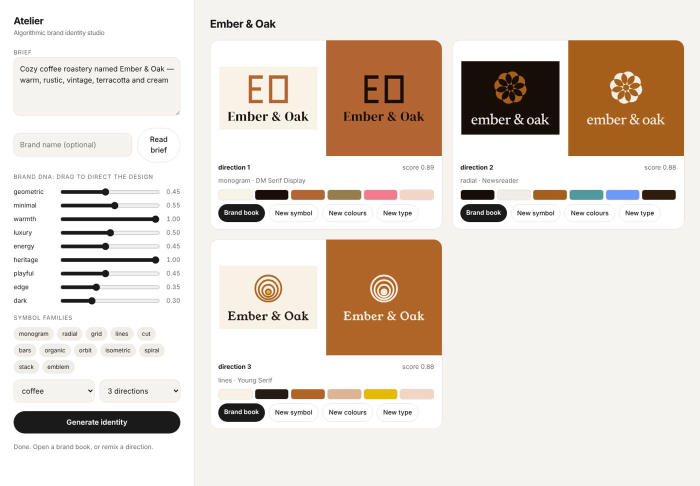

# Atelier — algorithmic brand-identity studio

Type a brief and get a full brand identity: symbol, wordmark, lockups, badge, colour system, typography, patterns, mockups and a brand book.

```bash
atelier new "a minimal, dark, rebellious streetwear brand called NOCTA"
```

**Nothing is AI-generated imagery.** Every mark, palette and layout is computed by code: constructed geometry, colour science and real typography. Every result is deterministic, reproducible from a seed and exported as clean vector files. AI is used in two narrow places only:

1. A **taste model** trained on reference images *you* collect. It learns your palette structures and composition, then ranks candidates by how close they are to that taste.
2. A small **fine-tuned open LLM** (Qwen2.5-1.5B, Apache-2.0, free) that turns a messy brief into the 8 design dials that drive the engine. It sets the dials; it never draws.



---

## What you get per brand

`out/<brand>/index.html` compares 3 ranked directions. Each direction contains:

| Folder | Contents |
|---|---|
| `brandbook.html` | Guidelines: Brand DNA, logo system, construction grid & clear space, badge, OKLCH palette with WCAG contrast checks, tonal scale, type specimen & modular scale, patterns, applications |
| `logo/` | symbol, horizontal + stacked lockups, wordmark (outlined paths, not live text), mono and reversed versions, badge, favicon. SVG + PNG |
| `color/` | `tokens.css`, `tailwind.config.js`, `palette.json` (50–950 scales for primary/secondary/accent) |
| `patterns/` | 3 brand patterns built from the identity's own geometry |
| `mockups/` | **apparel** kit (tee front/back, hangtag, woven neck label, tote), **digital** kit (landing page, app icon, UI components) or **print** kit (business cards, pouch/bottle packaging, poster), plus social posts |
| `brand.json` | the full spec. `atelier remix brand.json` regenerates or varies it |



## How it works

```
brief ──► Brand DNA ──► 24 candidates ──► critics + brief-fit + your taste ──► 3 diverse directions ──► kits
         (rules or        (seeded,           (ranked)                                                  (SVG/PNG/HTML)
          fine-tuned LLM)   algorithmic)
```

**Brand DNA** is 8 dials (0–1): `geometric · minimal · warmth · luxury · energy · heritage · playful · edge`, plus sector, dark-mode probability, hue hints and preferred symbol families. Every downstream decision is a function of these.

**Symbol engine:** 11 families of constrained generative systems. Each uses a small vocabulary of primitives, a symmetry group and a proportion system, which is why the results read as designed rather than random:

`monogram` (a constructed skeleton alphabet: one definition yields squared tech lettering through round geometric, inline, outline, stencil-slit and container knockouts, with shared-stem ligatures) · `radial` (n-fold petals, even-odd XOR overlaps) · `grid` (Bauhaus modules under mirror/rot2/rot4 symmetry) · `lines` (sunset bars, arches, multi-line letters, waves, ripples) · `cut` (negative-space bites, slashes, splits, apertures) · `bars` · `organic` (harmonic blobs, leaves, sprouts, blooms) · `orbit` (with true over/under ring interlacing) · `isometric` · `spiral` (golden-ratio quarters, sunflower phyllotaxis) · `stack`. Badges/emblems wrap the chosen symbol with text set on a circle.



**Colour:** palettes are built in OKLCH (perceptually uniform), with harmony schemes chosen by DNA, a chroma budget (energetic brands saturate, luxury brands whisper), tinted neutrals and guaranteed contrast (ink/paper ≥ 7:1, mark/paper ≥ 2.6:1, both tested).

**Typography:** 49 curated OFL Google Fonts, each tagged with a personality vector. Display and text faces are paired by DNA distance plus pairing rules. Case, weight and tracking are derived (luxury → wide-tracked caps, SaaS → tight lowercase, street → condensed/blackletter). Wordmarks are shaped with HarfBuzz (real kerning) and outlined to vector paths.

**Critics (no training needed):** ink coverage, optical balance, aspect, 24px favicon legibility (detail "mush" and downsample correlation), contrast, palette harmony, and whether the symbol and wordmark have matching visual weight. Plus a brief-fit score (symbol family, dark/light intent, type personality).

## Install

```bash
pip install -e .            # numpy, pillow, fonttools, uharfbuzz, resvg-py (no system deps)
atelier fonts               # optional: pre-cache the font library (~25 MB, fetched on demand otherwise)
atelier new "cozy coffee roastery named Ember & Oak, warm, rustic, terracotta"
atelier serve               # web studio at http://127.0.0.1:8765
```



The web studio shows the parsed DNA as sliders you can drag to direct the design before generating. Each direction has **New symbol / New colours / New type** remix buttons.

CLI reference:

```bash
atelier dna "..."                                   # see how a brief is read
atelier new "..." -k 4 -n 48 --family grid,monogram --dark true
atelier remix out/nocta/direction-1/brand.json --vary mark|palette|type|all
atelier marks --family radial -n 32                 # contact sheet to explore a family
```

## Teach it your taste

```
refs/
  likes/        # images you love. Sub-folders become style tags (refs/likes/streetwear/...)
  dislikes/     # optional: what to steer away from
```

```bash
atelier taste train refs -o taste_models/taste.json   # seconds, CPU, numpy only
atelier new "..."                                     # picks up taste_models/taste.json automatically
atelier taste score some-image.png                    # 0..1 fit + which features pull it away
```

The model extracts 14 design features from each image (background lightness/chroma, colour count, saturation, lightness range, hue spread, accent share, negative space, edge energy, symmetry, centre of mass, complexity, contrast) and fits a density over your likes, minus your dislikes. It also builds a **palette-structure bank**: the role relationships (paper/ink/primary/accent lightness, chroma and hue offsets) of references you love. New brands re-hue those structures, so your taste transfers without copying anyone's colours. Only statistics are stored, never images.

Validated in this repo: with quiet-luxury references as likes and loud references as dislikes, the likes score 0.57 vs 0.00, and the chosen directions for a neutral brief shift from chroma 0.145 to 0.034 (muted, like the references).

### Where to get references (legally)

- **Pinterest, your own boards, via the official API:** create an app at developers.pinterest.com, get an access token with `boards:read pins:read`, then:
  ```bash
  export PINTEREST_TOKEN=...
  atelier pinterest                         # lists your boards
  atelier pinterest --board <id> --out refs/likes/streetwear
  ```
  Pin titles and descriptions are saved as captions for the LLM dataset. Don't scrape Pinterest/Behance/Dribbble pages: it breaks their terms, and the images belong to their creators.
- Any URL list you're allowed to use: `atelier fetch urls.txt refs/likes` (`url<TAB>caption` per line).
- Your own screenshots and photos of packaging, shop fronts and garments you like.

## The fine-tuned model (brief → Brand DNA)

The rule parser works offline for free. The fine-tuned model understands vaguer, more human briefs ("like Aesop but for skaters, kind of moody") and your own vocabulary.

1. **Dataset:** `atelier llm dataset -o llm_data -n 6000 --images taste_models/taste.images.jsonl --captions refs/likes/captions.csv`
   - *synthetic*: DNA is sampled first, then a brief is **written from it** by a grammar (openers, sector phrases, intensity-graded adjectives, colours, audiences, cultural references, casual noise), so every pair is consistent;
   - *your references*: caption → DNA measured from the image, which grounds the model's language in your taste (upweighted ×3);
   - *optional paraphrases*: `--paraphrase 1500` rewrites briefs with Claude (`pip install anthropic`, `ANTHROPIC_API_KEY`).
2. **Train:** open [`notebooks/finetune_colab.ipynb`](notebooks/finetune_colab.ipynb) on a free Colab T4, or:
   ```bash
   pip install -e ".[llm]"
   python -m atelier.llm.train_lora --data llm_data --out checkpoints/atelier-dna
   python -m atelier.llm.merge_export --adapter checkpoints/atelier-dna --out checkpoints/atelier-dna-merged
   ```
   LoRA r=16 on all linear layers, loss on the JSON answer only, cosine LR, 2 epochs. `--load-4bit` for QLoRA on small GPUs.
3. **Measure:** `atelier llm eval --backend rules` is the baseline (on synthetic val: sector accuracy 0.73, axis MAE 0.132). Then `atelier llm eval --backend hf:checkpoints/atelier-dna-merged`. Ship the model only if it beats the baseline.
4. **Use:** convert to GGUF, `ollama create atelier-dna -f checkpoints/Modelfile`, then `atelier new "..." --llm ollama:atelier-dna`. Also supported: `hf:<path>`, `openai:<base_url>:<model>` (vLLM / llama.cpp server), `anthropic:<model>`. Model output is always validated and clamped, and any failure falls back to the rule parser.

### Spending the $100 credit well

| Item | Rough cost |
|---|---|
| Rule parser, critics, taste model, rendering | $0 (CPU) |
| LoRA fine-tune of the 1.5B model | $0 on free Colab T4; a few dollars on a rented 24 GB GPU (RunPod/Vast/Lambda) for ~1 hour |
| Paraphrasing ~1,500 briefs with Claude (optional) | a few dollars of API credit |
| Running the fine-tuned model | $0 locally with Ollama |

That leaves most of the credit for experiments: a 3B/7B base model, a bigger dataset, or several training runs compared with `atelier llm eval`. Check current provider prices before you start.

## Project layout

```
atelier/
  color.py        OKLab/OKLCH, gamut mapping, WCAG contrast, palette generator, tonal scales
  fonts.py        curated font library + personality vectors, fetch cache, HarfBuzz shaping → outlines
  dna.py          Brand DNA + sector priors
  brief.py        lexicon parser + LLM backends + validation
  marks/          letters.py (skeleton alphabet), families.py (11 generators + emblem), registry.py
  identity.py     palette + type + mark + badge → lockups
  patterns.py     monogram / truchet / stripes / halftone / contour / modules
  mockups.py      apparel, digital and print applications
  brandbook.py    HTML guidelines        tokens.py  CSS / Tailwind / JSON
  taste/          features.py, model.py (KDE + palette bank), critics.py, ingest.py, fetch.py (URLs, Pinterest API)
  llm/            dataset.py, train_lora.py, merge_export.py, infer.py, evaluate.py
  studio.py       explore → score → diversify → export        server.py + web/  local studio
```

Run the tests with `pip install -e ".[dev]" && pytest`. Fonts are fetched from Google Fonts on first use, so the first run needs internet.

## Ideas for next steps

- A CLIP-embedding taste head on top of the handcrafted features, to capture style the 14 features miss.
- More symbol families (letter-pair interlocks, ribbons, stencil systems) and more mockups (hoodie, cap, storefront, billboard).
- Let the LLM also write the brand copy (taglines, voice) shown in the mockups.
